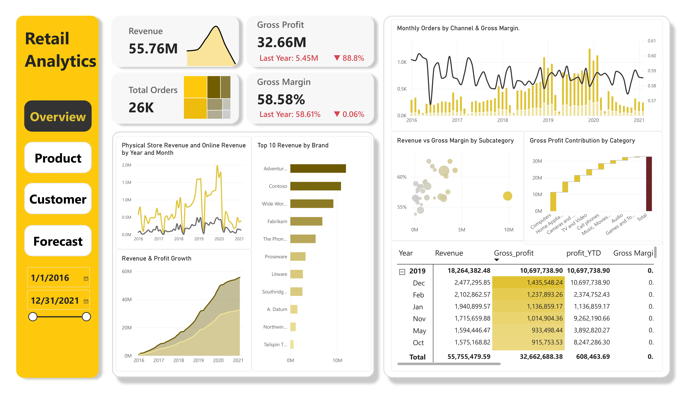
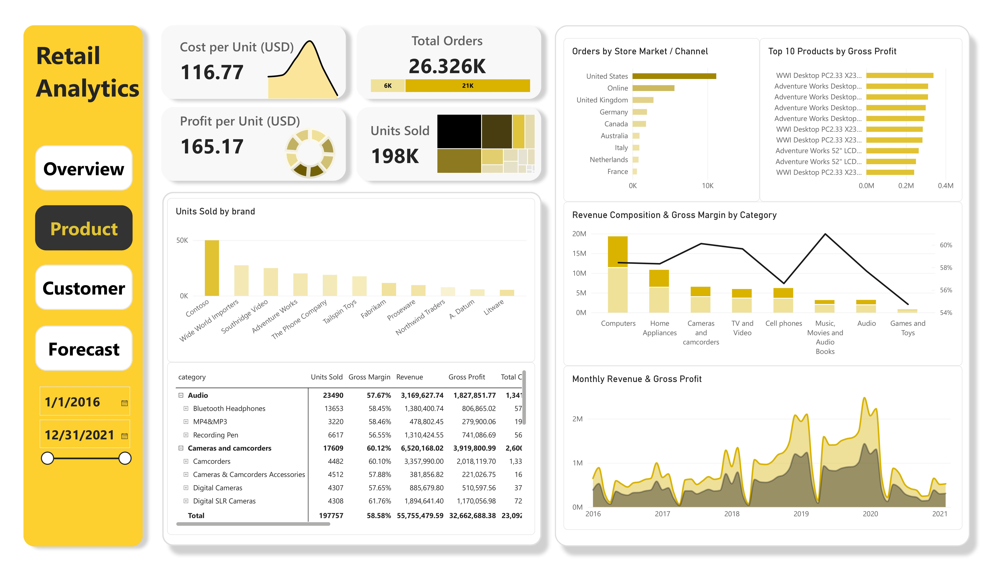
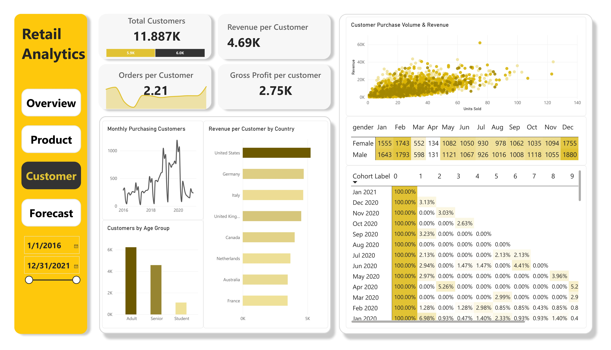
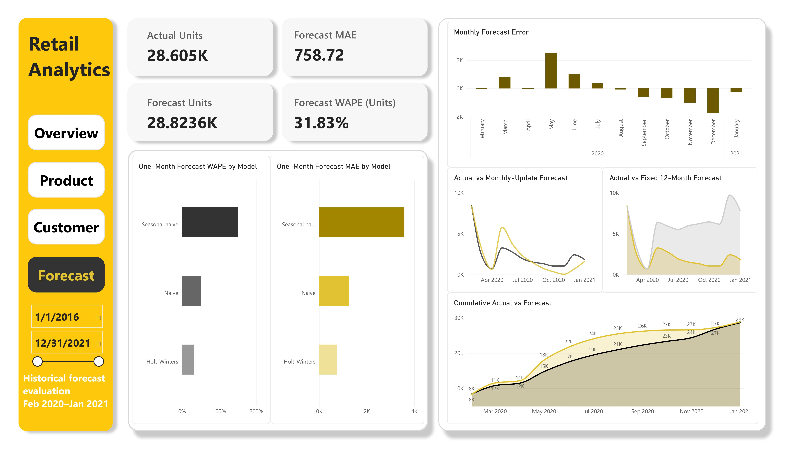

# Retail Commercial Analytics & Sales Forecasting

A portfolio project using **SQL, Python, and Power BI** to investigate retail performance, customer purchasing behavior, and the reliability of monthly sales forecasts.

## Executive Summary

The analysis covers **62,884 sales line items**, representing **26,326 orders** and **11,887 purchasing customers**. Total revenue was **$55.76 million**, with **$32.66 million in gross profit** and a **58.58% gross margin**.

Computers generated the largest revenue and gross profit among product categories. Customer segmentation also identified a concentration of revenue among high-value customers.

Forecasting results were mixed. A fixed 12-month Holt-Winters forecast performed poorly during the final test period. A supplementary monthly-update evaluation achieved **31.83% WAPE** and **39.62% lower MAE than a one-month-ahead naïve baseline**.

These findings support further testing of monthly forecast updates for short-term planning. They do not establish reliable annual forecasts or measured business improvements.

## Business Questions and Scope

| Question | Outcome and comparison | Intended decision |
|---|---|---|
| Which product groups contribute most to commercial performance? | Revenue, gross profit, margin, and units sold across categories and brands | Prioritize categories for further commercial review |
| How does purchasing behavior vary across customers? | Purchase frequency, spending, RFM segments, and cohort retention | Identify customer groups for targeted campaign testing |
| How accurately can aggregate monthly sales be forecast? | Units-sold forecasts compared with naïve and seasonal-naïve baselines | Assess whether monthly updates merit further use in short-term planning |

**Population:** transactions, products, and purchasing customers observed in the dataset.

**Reporting period:** January 2016–20 February 2021.

**Forecast test period:** February 2020–January 2021.

The project combines descriptive and predictive analysis. It does not estimate causal effects of promotions, pricing, or retention campaigns.

## Data and Quality Checks

The analytical dataset was prepared from retail sales, product, customer, and store tables accessed through Xóm Data.

| Metric | Value |
|---|---:|
| Sales line items | 62,884 |
| Orders | 26,326 |
| Purchasing customers | 11,887 |
| Units sold | 197,757 |
| Revenue | $55,755,479.59 |
| Total cost | $23,092,791.21 |
| Gross profit | $32,662,688.38 |

Preparation and validation included:

- Checking the uniqueness of the order-number and line-item key.
- Reconciling record counts and business totals between SQL and Python.
- Retaining structurally missing delivery information for physical-store transactions and store area for online transactions.
- Excluding incomplete February 2021 from monthly forecasting while retaining it in descriptive reporting.

Gross margin is calculated as **total gross profit divided by total revenue**, rather than an unweighted average of transaction margins.

## Methods and Deliverables

| Workstream | Methods | Deliverable |
|---|---|---|
| Data preparation | SQL profiling, joins, validation, and Python reconciliation | Analytical dataset and preparation notebook |
| Commercial reporting | Power BI star schema, DAX measures, and drill-down analysis | Overview and Product dashboards |
| Customer analysis | RFM segmentation, purchasing metrics, and cohort analysis | Customer notebook and dashboard |
| Forecast evaluation | Chronological validation, Holt-Winters, and baseline comparisons | Forecast notebook and dashboard |

## Main Findings

### Product performance

Computers generated approximately **$19.30 million in revenue** and **$11.28 million in gross profit**. High revenue should be assessed alongside margin and profit per unit before making product-level decisions.

### Customer concentration

The RFM Champions segment represented **14.97% of customers** and contributed **33.64% of historical revenue**. This identifies a commercially important segment, but does not prove future loyalty or the effectiveness of a retention intervention.

### Forecast reliability

Holt-Winters with a damped additive trend and multiplicative seasonality was selected using validation MAE.

**Original fixed-origin test: forecasts for 12 months generated at the end of January 2020**

| Model | MAE — units | WAPE |
|---|---:|---:|
| Holt-Winters | 3,652.63 | 153.23% |
| Seasonal naïve | 3,579.92 | 150.18% |

Holt-Winters did not outperform seasonal naïve in this test. Both produced substantial errors.

**Supplementary evaluation: models updated monthly to forecast one month ahead**

| Model | MAE — units | WAPE |
|---|---:|---:|
| Holt-Winters | 758.72 | 31.83% |
| Naïve | 1,256.50 | 52.71% |
| Seasonal naïve | 3,579.92 | 150.18% |

Monthly-update Holt-Winters reduced MAE by **39.62% compared with the matching naïve baseline**.

The monthly-update experiment was conducted after inspecting the original test results. Its findings require confirmation on additional periods. Comparing it with the fixed-origin approach also changes both the forecast horizon and the information available.

## Power BI Dashboards

### Business Overview

Revenue, profitability, orders, channels, and geographic performance.

### Product Analysis

Category contribution, product profitability, brand performance, and sales volume.

### Customer Analysis

Purchasing activity, customer value, demographic groups, and cohort retention.

### Sales Forecasting

Historical forecast evaluation, model comparisons, monthly errors, and cumulative actual versus forecast units.

## Recommendations and Monitoring

| Proposed action | Condition and monitoring |
|---|---|
| Review commercially important product categories | Examine gross profit, margin, and units together before changing assortment or pricing |
| Test targeted campaigns for selected customer segments | Use a comparison group and measure incremental gross profit after campaign costs |
| Pilot monthly forecast updates | Evaluate on additional periods and monitor MAE, WAPE, and the direction of monthly errors against naïve baselines |
| Investigate the decline in observed sales | Check completeness and changes by channel, market, and category before assigning a cause |

These are proposed actions. No campaign uplift, cost savings, or operational deployment is claimed.

## Limitations and Further Work

- **Partial final year:** 2021 ends on 20 February. Comparing it with a full previous year can exaggerate an apparent annual decline.
- **Limited forecast evaluation:** the final test contains 12 months. Results may not generalize to other periods.
- **Aggregate forecasts:** business-level units do not establish accuracy for individual products or stores.
- **Observed customer history:** first observed purchase may not be first-ever purchase. Longer-tenure customers have more time to accumulate spending and orders.
- **Demographic proxies:** the “Student” age-group label does not establish enrollment.
- **Uncertainty:** forecast intervals are not provided. Additional evaluation across time windows and business segments remains future work.

## Repository and Reproduction

- [SQL scripts](SQL/)
- [Data preparation notebook](notebooks/01_data_preparation.ipynb)
- [Customer analysis and forecasting notebook](notebooks/retail_customer_analysis_and_forecasting.ipynb)
- [Power BI report](PBI/retail%20analytics.pbix)
- [Dashboard images](images/)

To inspect the work, open the notebooks and dashboard screenshots, or download the report for Power BI Desktop.

To rerun the analysis, provide the CSV inputs requested by the notebooks and execute cells in order. Export the forecasting results before refreshing the Forecast dashboard. Power BI source paths must be configured for the local environment.

The repository is not presented as a fully automated, one-command pipeline.
